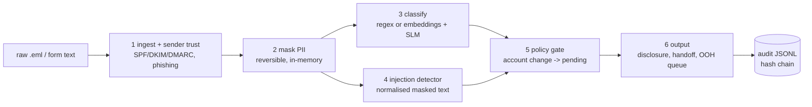

# written-channel-triage

One safe entry point for written customer support (email + web-form text) at the
**fictional** NordTel GmbH. It triages a message — checks the sender, masks personal
data, classifies the request, looks for prompt injection, and gates risky actions —
**before** anything reaches an LLM or a human.

Personal portfolio project. All data is synthetic German/English generated in this repo
with a fixed seed. No real brand, no real customer data, and **nothing here is a
certification**.

> **v2** adds a real local SLM and multilingual embedding retrieval behind the v1
> protocol, a seeded ~2,050-item dataset with a held-out test split, a three-system
> evaluation, hardened security, and a FastAPI + Docker delivery surface. The v1 baseline
> (offline, deterministic) still runs with the Python standard library alone.

## Problem

Many German telcos dropped a general support email address and spread written requests
across many web forms; chat handoff is slow and has no upload. There is no single written
front door that is safe by default: one that won't leak personal data into a model, won't
be steered by a prompt-injection string, and won't let an attacker trigger an account
change. I wanted to build that front door and be able to defend every decision in a
review.

## Solution

A fixed, explainable pipeline. Each step is a small module with its own tests and a reason
string, so one decision can be reviewed at a time.



**Safe by default:** mask before the model · injection detector on the masked text ·
no auto account changes (pending approval) · never silently close out of hours ·
tamper-evident audit log. v2 closes the two gaps the v1 eval exposed (obfuscated
injection, a phishing false positive) and adds a post-model PII re-check.

## Results

Numbers come only from a run. The eval compares five systems — **A** v1 regex/keyword,
**B** embeddings-only, **C** embeddings + SLM, **D** embeddings + trained
LogisticRegression, **E** D with the SLM only on low-confidence items — on the
**held-out test split** (split by template family) and separately on a **hand-varied
unseen set** (`eval/unseen/`, 200+ items). All tables below are **generated** from
[`eval/results-v2.json`](eval/results-v2.json) by `make docs`; nothing here is typed by
hand, and every real-model row stays "pending real run" until the models are run.

<!-- BEGIN:results-table -->
| system | split | accuracy | macro-F1 | latency p50 / p95 ms |
|---|---|---|---|---|
| A - v1 regex/keyword | - | pending real run | pending real run | pending real run |
| B - embeddings-only | - | pending real run | pending real run | pending real run |
| C - embeddings + SLM | - | pending real run | pending real run | pending real run |
| D - embeddings + LR | - | pending real run | pending real run | pending real run |
| E - LR, SLM on low conf | - | pending real run | pending real run | pending real run |
<!-- END:results-table -->

Detectors. PII masking is checked with a **fuzzy ground-truth** comparison (partial
ratio ≥ 0.85, IBAN fragment ≥ 8 chars) against the values the generator actually placed,
not the masker's own regex:

<!-- BEGIN:detector-table -->
| detector | split | precision | recall | FPR |
|---|---|---|---|---|
| (all) | test | pending real run | pending real run | - |
| (all) | unseen | pending real run | pending real run | - |
<!-- END:detector-table -->

Calibration (Expected Calibration Error on the test split). System C's self-reported
confidence is near-constant, so it is reported honestly and **not** used to route;
System D is calibrated on dev and its probability drives the human-review threshold
([ADR 0007](docs/adr/0007-calibrated-review-threshold.md)):

<!-- BEGIN:calibration-table -->
| system | ECE (test) | note |
|---|---|---|
| A - v1 regex/keyword | pending real run | - |
| B - embeddings-only | pending real run | - |
| C - embeddings + SLM | pending real run | - |
| D - embeddings + LR | pending real run | - |
| E - LR, SLM on low conf | pending real run | - |
<!-- END:calibration-table -->

Cost per 1,000 messages is derived from measured CPU seconds and a clearly labelled VM
price assumption:

<!-- BEGIN:cost-table -->
ASSUMPTION: $0.192/h for AWS m6i.xlarge (4 vCPU / 16 GB), on-demand, region us-east-1, as of 2025-01 (source: AWS EC2 on-demand pricing page). Replace with your own rate.

| system | harness CPU s/item | Ollama CPU s/item | cost per 1k msg (USD) | harness RSS (MB) | Ollama RSS (MB) |
|---|---|---|---|---|---|
| A - v1 regex/keyword | pending real run | pending real run | pending real run | pending real run | pending real run |
| B - embeddings-only | pending real run | pending real run | pending real run | pending real run | pending real run |
| C - embeddings + SLM | pending real run | pending real run | pending real run | pending real run | pending real run |
| D - embeddings + LR | pending real run | pending real run | pending real run | pending real run | pending real run |
| E - LR, SLM on low conf | pending real run | pending real run | pending real run | pending real run | pending real run |
<!-- END:cost-table -->

The split is by template family, so no test template appears in train; a leakage gate
(`make overlap-check`) fails the build if any test **or unseen** item is ≥0.9 similar to
a train, example or generator-template string. The large **test vs unseen** gap is
reported on purpose: it is the honest measure of how well each system generalises to
phrasings it has never seen. The confusion matrices (PNG + CSV), reliability PNGs and
per-split [`docs/error-analysis.md`](docs/error-analysis.md) come from the same run;
dataset distributions are in [`docs/datasheet.md`](docs/datasheet.md).

## Architecture

- [`docs/architecture.md`](docs/architecture.md) — context, container/deployment, trust
  boundaries, data flow with PII, scaling, ops/observability, cost table.
- [`docs/adr/`](docs/adr/) — 6 ADRs behind the v2 decisions.
- [`docs/threat-model.md`](docs/threat-model.md) — STRIDE per boundary → OWASP LLM Top 10
  (2025) + MITRE ATLAS, mitigation and covering test.
- [`docs/spec/`](docs/spec/) — v1 and v2 requirements (EARS), design, tasks.

## Run it in 10 minutes

**Offline, no model (default — stdlib + pytest):**

```bash
make test                 # unit tests (models + API paths skip if extras absent)
make data                 # regenerate the seeded dataset into data/*.jsonl
make datasheet            # regenerate docs/datasheet.md from the data
make eval                 # offline eval: System A measured, B/C pending real run
```

**With the real models (your machine):**

```bash
# 1. Install extras
pip install -e ".[models,eval,learned,api]"
# 2. Start Ollama and pull the default model
ollama serve &
ollama pull qwen2.5:1.5b-instruct
# 3. Train the LR heads on train.jsonl (writes models/ + manifest.json)
make train
# 4. Run all five systems; writes results-v2.json, confusion/reliability PNG+CSV,
#    error analysis. Then regenerate the doc tables from the results.
make eval-real
make docs
```

**As a service (Docker):**

```bash
docker compose up --build
docker compose exec ollama ollama pull qwen2.5:1.5b-instruct
curl -s localhost:8000/triage -H 'content-type: application/json' \
     -d '{"text":"Mein Internet ist tot, Störung.","source":"form"}'
curl -s localhost:8000/metrics        # Prometheus text exposition
```

## Layout

```
src/triage/   pipeline modules + normalize, retrieval, learned (LR), api, observability
data/         seeded generator + train/dev/test.jsonl + datasheet + overlap_check
eval/         harness_v2 (5 systems), metrics, systems, train_models, pii_leak_check,
              unseen/ (200+ hand-varied items), results-v2.json
models/       trained LR artifacts + manifest.json (written by `make train`)
docs/         architecture, threat-model, datasheet, error-analysis, adr/, spec/
Dockerfile, docker-compose.yml, Makefile
LEARNINGS.md  the concepts, tools, and the "why" behind each decision
```

## Learnings and limits

[`LEARNINGS.md`](LEARNINGS.md) has the concepts and the "why" for every decision, v1 and
v2, including the honest limits: the scores are on synthetic data, they are not a
benchmark, and they say nothing about real traffic.
