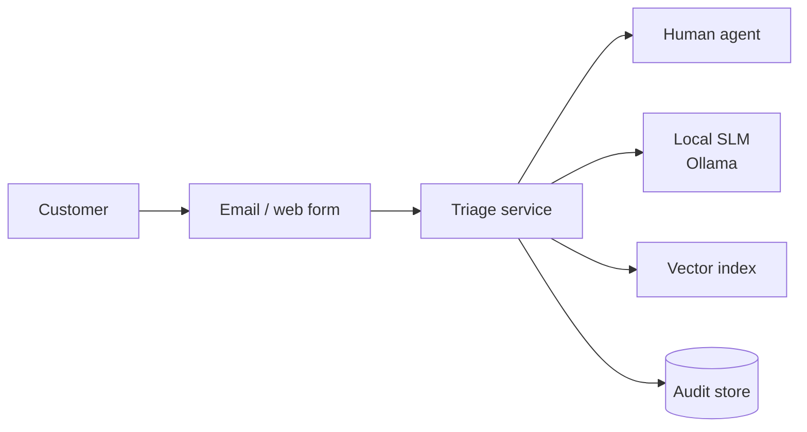
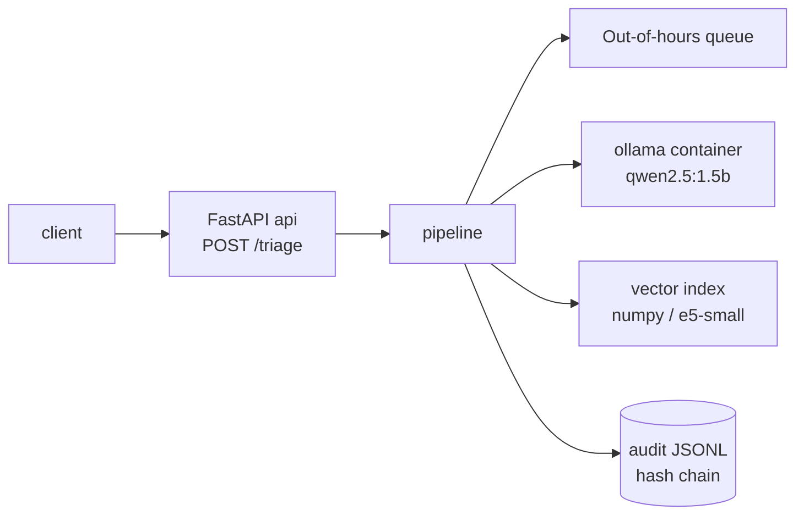
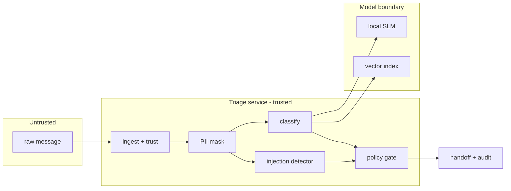
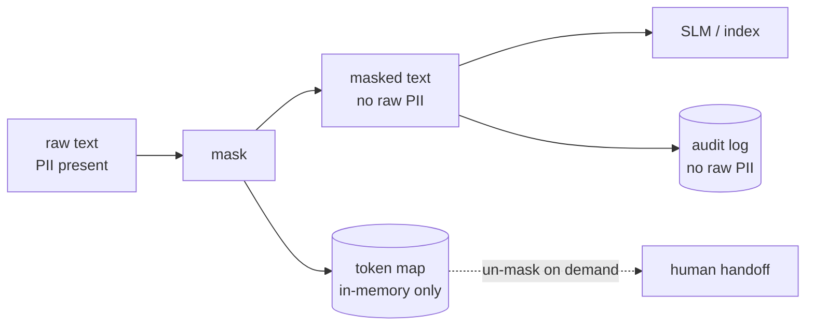

# Architecture — written-channel-triage (v2)

One safe written entry point for customer support at the **fictional** NordTel GmbH.
A message (email or form text) runs through a fixed, explainable pipeline before it
reaches an LLM or a human: check the sender, mask PII, classify, detect injection, gate
risky actions, and hand off with an audit record. v2 adds a real local SLM and embedding
retrieval behind the v1 protocol, a FastAPI surface, and a queue for out-of-hours.

Synthetic data only. Nothing here is a certification, and every measured number lives in
a file a run produced (`eval/results-v2.json`, `docs/datasheet.md`).

## 1. Context view



The triage service is the only thing that touches the raw message. The SLM and the vector
index are local and see **masked** text only. The human agent receives a handoff summary,
never the raw PII unless they explicitly un-mask in-session.

## 2. Container / deployment view



- **api** — the FastAPI service (`src/triage/api.py`), one process, stateless per request.
- **ollama** — the SLM server, its own container; the model is pulled once and kept warm.
- **vector index** — built in-process from the category descriptions + few-shot examples;
  tiny, so it lives with the API rather than in a separate service.
- **queue** — out-of-hours requests are parked with an ETA, not dropped (see §6).
- **audit store** — append-only hash-chained JSONL.

Compose brings up `api` + `ollama`; the index and the queue are in-process.

## 3. Trust boundaries



Three boundaries matter:
1. **Untrusted → service.** The raw message is attacker-controlled. Ingest/trust and
   phishing rules run here; nothing is trusted on the word of the message.
2. **Service → model.** Only **masked** text crosses into the SLM / index. The injection
   detector runs just before this crossing, on the same masked text the model sees.
3. **Service → human / log.** The handoff and the audit log receive verdicts and masked
   text only; a guard refuses to write raw IBAN/email to the log.

## 4. Data flow and where PII lives



- Raw PII exists **only** between parse and mask, and inside the in-memory token map for
  the request lifetime. It is never written to disk, the log, or the model prompt.
- The token map is the single place a raw value can be recovered, and only in-process.
- After the SLM returns, a re-check (`pii.contains_raw_pii`) drops any field value that
  carries unmasked PII, so a model that echoes a value cannot leak it onward.

## 5. Scaling notes

- The pipeline is **stateless per request**; scale the API horizontally behind a load
  balancer. The only shared state is the audit log (append-only) and the queue.
- The SLM is the latency floor. On CPU, `qwen2.5:1.5b-instruct` at temperature 0 is the
  dominant cost; the regex and embedding steps are sub-millisecond on the test split
  (System A p50/p95 are in `eval/results-v2.json`).
- The vector index is small (a few dozen rows) and rebuilt at startup; no index service
  is needed. If the category set grew by orders of magnitude, swap the numpy search for
  FAISS behind the same `.search()` method.
- Out-of-hours load is absorbed by the queue; business-hours load is bounded by SLM
  throughput, so size the `ollama` replica count to the expected concurrent SLM calls.
- The audit log is append-only; rotate by day and verify the chain on rotation.

## 6. Ops / observability

**Structured logs** (one JSON object per decision; no raw PII):

```json
{"ts":"...","event":"triage","source":"form","trust":"unknown",
 "category":"Rechnung","confidence":0.42,"injection":[],"phishing":[],
 "policy_allowed":true,"queued":false,"slm_fallback":null}
```

**Metric names** (what I would export to Prometheus):

| metric | type | meaning |
|---|---|---|
| `triage_requests_total` | counter | requests by `source`, `category` |
| `triage_injection_detected_total` | counter | injection hits by rule |
| `triage_phishing_suspected_total` | counter | phishing hits by rule |
| `triage_policy_blocked_total` | counter | account-changing requests parked for a human |
| `triage_slm_fallback_total` | counter | SLM calls that fell back to the baseline |
| `triage_pii_leak_blocked_total` | counter | SLM outputs with raw PII that were dropped |
| `triage_request_latency_ms` | histogram | end-to-end latency, labelled by system |
| `triage_queue_depth` | gauge | out-of-hours queue depth |

**Alerts worth having:** SLM fallback rate climbing (model unhealthy), injection-hit rate
spiking (attack campaign), audit chain verification failing (tampering).

## 7. Cost table (CPU, pending real run)

Costs are a function of measured SLM latency on CPU. The latency numbers come from the
eval run; until a real-model run fills them in, this table is **pending real run** and
contains no invented values.

| system | p50 latency | p95 latency | relative cost note |
|---|---|---|---|
| A — v1 regex | see `results-v2.json` | see `results-v2.json` | ~free (CPU, no model) |
| B — embeddings-only | pending real run | pending real run | one embedding encode per request |
| C — embeddings + SLM | pending real run | pending real run | one encode + one SLM generate |

Once the real run is in, the cost column is derived as (p95 latency × vCPU-hour price) /
requests-per-hour — all from measured latency, no guesses.

## 8. Related docs

- Design rationale: [`docs/spec/v2-design.md`](spec/v2-design.md)
- ADRs: [`docs/adr/`](adr/)
- Threat model: [`docs/threat-model.md`](threat-model.md)
- Datasheet: [`docs/datasheet.md`](datasheet.md)
- Error analysis: [`docs/error-analysis.md`](error-analysis.md)
