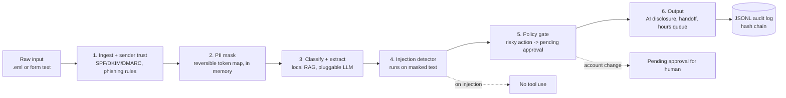

# Design — written-channel-triage

I want one written entry point that runs a message through a fixed, explainable pipeline
before it reaches an LLM or a human. Each step is a small module with its own tests, so I
can reason about one decision at a time and show the "why" in a code review.

## Design goals

- **Safe by default.** Mask PII before any model call; detect injection on the masked
  text; never auto-execute an account-changing action.
- **Explainable.** Every step returns a reason string, not just a label.
- **Offline.** The default path is the Python standard library plus a deterministic,
  pluggable LLM so CI needs no network or model.
- **Traceable.** Each decision is written to a hash-chained JSONL audit log.

## Pipeline overview



## Module layout

```
src/triage/
  models.py        # dataclasses: Request, Verdict, TriageResult, PendingApproval
  ingest.py        # R1-R5: parse .eml / form text, SPF/DKIM/DMARC, phishing rules
  pii.py           # R6-R9: reversible masking + in-memory token map
  categories.py    # R10, R12: category definitions and required fields
  classify.py      # R10-R13: local retrieval + pluggable LLM, field extraction
  llm.py           # R11: LLM protocol + offline deterministic default + mock
  injection.py     # R14-R16: prompt-injection detector
  policy.py        # R17-R19: policy gate, pending approvals
  output.py        # R20-R22: AI disclosure, handoff summary, out-of-hours queue
  audit.py         # R23: hash-chained JSONL audit log
  pipeline.py      # orchestrates the steps end to end
eval/
  corpus.py        # R24: generate ~100 synthetic German messages
  harness.py       # R25: run pipeline, measure precision/recall, write results.json
```

## Key decisions and why

### Why rule-based ingest and phishing (R5)
Trust decisions must be auditable and stable. SPF/DKIM/DMARC already give a signal; I read
the `Authentication-Results` header and combine it with a small set of phishing heuristics
(fake-invoice wording, lookalike domain, urgent payment link). No model in this step means
no model risk in the part that decides whether to trust the sender.

### Why mask before the model (R6, R14)
The model (and the human handoff, and the log) should never see raw PII. Masking first also
means the injection detector and classifier operate on normalized placeholders, which keeps
their behaviour stable. The token map lives only in memory for the request lifetime, so a
leaked log cannot be de-anonymised.

### Why a pluggable LLM with an offline default (R11, N1, N3)
I define a tiny `LLMClient` protocol. The default `OfflineClient` is deterministic and uses
the local retrieval score plus simple keyword signals — no network, no download. A
`MockClient` lets a test force an answer. A real local model (e.g. an Ollama adapter) can be
dropped in later without touching the pipeline. This keeps CI free and reproducible.

### Why injection detection runs on masked text (R14)
If masking changed the injection surface, I would be testing the wrong string. Running the
detector after masking means the thing I check is exactly the thing the model would see.

### Why the policy gate never executes account changes (R17-R19)
Tariff change, cancellation, address change, and SEPA change can harm a customer if done
wrongly or by an attacker who passed earlier checks. These always become a pending approval
for a human. Read-only answers (status, info) may proceed. This is the core safety property.

### Why out-of-hours queues instead of closing (R22)
Silently closing a written request outside business hours is the failure mode I am reacting
to. Outside 07:00–23:00 the request is queued with an ETA for the next opening, never dropped.

### Why a hash-chained audit log (R23)
Each JSONL line stores the SHA-256 of the previous line. Any edit or deletion breaks the
chain, so the log is tamper-evident. No unmasked PII is ever written to it.

## Data model (summary)

- `Request(source, raw_text, subject, sender, auth_results)`
- `Verdict(level, reason, matched_rules)`
- `Classification(category, confidence, fields, missing_fields)`
- `PendingApproval(action, reason, created_at)`
- `TriageResult(trust, phishing, classification, injection, policy, output, audit_entry)`

## Error handling

- Unparseable `.eml` falls back to treating the whole payload as form text with trust
  "unknown (no headers)" (R2), rather than failing the request.
- A missing `Authentication-Results` header yields trust "unknown", not "pass".
- Any step that cannot decide returns a verdict with reason "undetermined" and routes the
  request to a human; the pipeline never silently drops a message.
