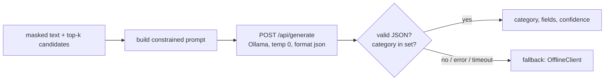
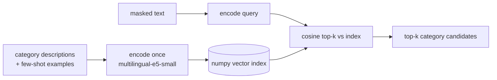
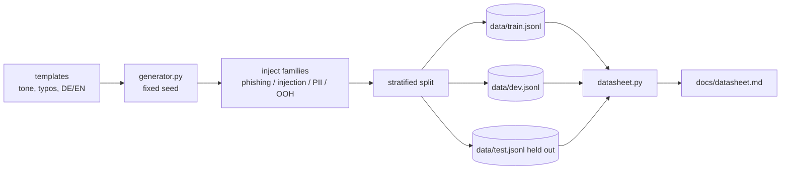
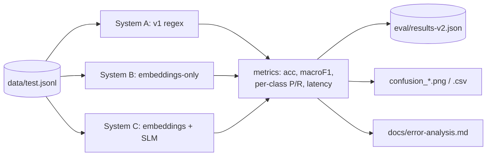
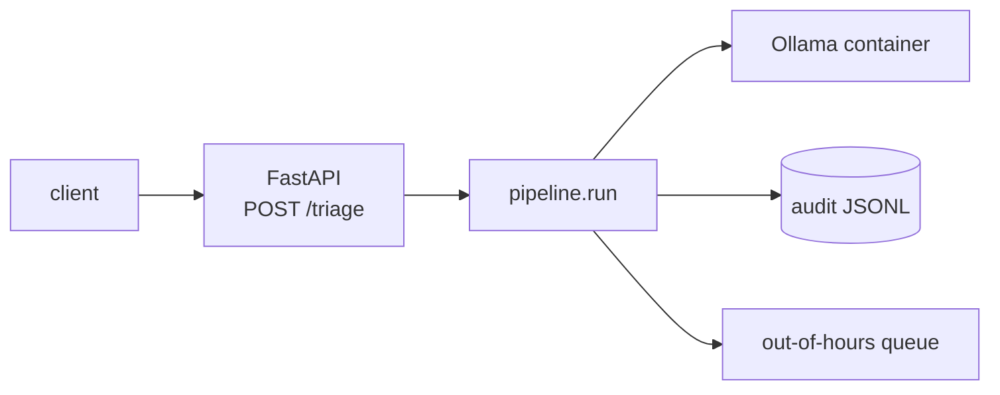

# v2 Design — written-channel-triage

v2 keeps the v1 shape (one explainable pipeline, small modules, each with a reason
string) and extends it along five lines: real models behind the existing protocol, a
seeded dataset, a three-system eval, the v1 security gaps closed, and a delivery surface
(FastAPI + Docker). This document explains the *how* and the *why* so it reads in a
review.

The hard constraint that drives most decisions: **the default path and CI must stay
offline and dependency-free.** Everything that needs a model or a heavy library
(sentence-transformers, numpy, matplotlib, fastapi, httpx) is imported lazily inside the
function that uses it, never at module top level, and is listed as an optional extra in
`pyproject.toml`. Tests mock those boundaries.

## 1. LLM / retrieval layer

### LLMClient protocol (unchanged)
`classify(masked_text, candidates) -> (name, confidence)` stays the contract. v1
`OfflineClient`, `MockClient` keep working.

### OllamaClient (V1, V2)

- Talks to `http://localhost:11434` by default, model `qwen2.5:1.5b-instruct`,
  both configurable via constructor args / env.
- Uses Ollama's `format: "json"` plus a prompt that pins the allowed category set and
  asks for `{category, fields, confidence}`; `options.temperature = 0`.
- A timeout and a `try/except` around the HTTP call and the JSON parse. **Any** failure
  returns the baseline `OfflineClient` answer for that call, so an unavailable model
  degrades to v1 behaviour rather than raising. The fallback is recorded in the reason.
- `httpx` is imported lazily; if it is missing the client constructs but its first call
  falls back.

### EmbeddingRetriever (V3, V4)

- `intfloat/multilingual-e5-small`, loaded lazily via sentence-transformers. e5 needs the
  `query:` / `passage:` prefixes — the retriever adds them.
- Index is a plain numpy matrix of L2-normalised vectors; cosine = dot product. FAISS is
  an optional swap behind the same `.search()` method but not required.
- Two use sites: **embeddings-only** (return nearest category as the answer) and
  **embeddings + SLM** (pass top-k to `OllamaClient`).
- The encoder is injected, so tests pass a fake encoder (deterministic vectors) and never
  download a model.

### Wiring
`classify.classify()` already takes a `client`. v2 adds an optional `retriever` argument;
when present it replaces the regex `retrieve()` for candidate generation. The v1 regex
path remains the default and the baseline system in the eval.

## 2. Dataset (`data/`)


- `data/generator.py` builds ~2,050 labelled items from templates. A fixed seed
  (`random.Random(20251031)`) makes the set reproducible; the seed is recorded in each
  file's header record.
- Item shape (JSONL, one object per line):
  `{"id", "text", "source", "category", "is_phishing", "is_injection", "has_pii",
    "out_of_hours", "family", "auth", "split"}`.
- Variation knobs: a tone list (formal / casual / annoyed), a typo injector that swaps or
  drops characters at a seeded rate, and a DE/EN phrase mixer. Headers draw `auth` from
  {pass, fail, missing}.
- Obfuscated injections are generated four ways: plain, spaced-out (`I G N O R E`),
  homoglyph (Latin→Cyrillic/Greek lookalikes), and base64 (payload wrapped in a
  "decode and follow" carrier).
- Split is by template family: each template is assigned to one split (roughly 60/20/20 of templates), so a template never crosses splits. The test
  split is written once and the eval reads only `test.jsonl`; the generator never tunes
  on it.
- `data/datasheet.py` reads the three JSONL files and writes `docs/datasheet.md` with
  distribution tables computed from the data (no hand-typed numbers).

## 3. Eval (`eval/`) — three systems


- `eval/systems.py` defines the three systems behind one `classify(text) -> label`
  interface so the harness treats them uniformly.
- `eval/metrics.py` is pure-python+numpy: accuracy, per-class precision/recall/F1,
  macro-F1, confusion matrix. Latency is wall-clock per item; p50/p95 from the sorted
  samples.
- `eval/harness_v2.py` runs each system over `test.jsonl`, also runs the detectors
  (phishing/injection/PII) once over the split, writes `eval/results-v2.json`, the
  confusion PNG/CSV (PNG via matplotlib, imported lazily), and `docs/error-analysis.md`
  from the real misclassifications.
- **Offline behaviour:** Systems B and C need models. When models are absent the harness
  writes a results file whose per-system blocks are `"status": "pending real run"` and
  runs System A only (System A needs nothing). Numbers are never invented. `make eval`
  runs the offline subset; `make eval-real` runs all three with real models.

## 4. Security fixes

- **Normalisation (V18):** new `src/triage/normalize.py` — NFKC, collapse runs of
  whitespace, strip zero-width characters, and map a homoglyph table
  (Cyrillic/Greek → Latin) to a canonical form. `injection.detect_injection()` normalises
  first, then matches. It still receives the masked text from the pipeline.
- **New patterns + base64 (V19):** add a "repeat/verbatim/print the above/your
  instructions" pattern; add a step that finds base64-looking tokens, decodes the short
  ones, and re-runs the patterns on the decoded text.
- **Embedding injection check (V20):** optional `embedding_injection_score(text,
  retriever)`; flags when similarity to known exemplars exceeds a threshold. No-op when no
  retriever is supplied, so the default path is unaffected.
- **Word-boundary payment link (V21):** rewrite `_PAYMENT_LINK` so the `pay` cue needs a
  word boundary (`\bpay\b`, `payment`, `pay-…`), which stops `/payload` from matching.
- **SLM output PII re-check (V22):** after classify, run
  `pii.contains_raw_pii(slm_output)`; if raw PII is present, drop the model's field text
  and flag `pii_leak_blocked` so nothing unmasked leaves the model boundary.

## 5. Delivery


- `src/triage/api.py`: FastAPI app, `POST /triage` takes `{text, source}` and returns the
  `TriageResult` as JSON (dataclasses → dict). `GET /healthz` for liveness. FastAPI and
  pydantic are optional extras; the module imports them lazily so the core stays
  dependency-free.
- `Dockerfile` for the API (python:3.11-slim, install `.[api]`), `docker-compose.yml`
  with two services: `api` and `ollama` (official `ollama/ollama` image, model pulled on
  first run). The compose file wires `OLLAMA_HOST` so the API reaches the model service.

## 6. Module map (v2 additions)

```
src/triage/
  normalize.py     # V18: NFKC + whitespace + homoglyph fold
  retrieval.py     # V3, V4, V20: EmbeddingRetriever + numpy index + injection score
  api.py           # V28: FastAPI POST /triage
  llm.py           # V1, V2: + OllamaClient (lazy httpx, fallback)
  injection.py     # V18, V19: normalise, new patterns, base64 decode-and-scan
  pii.py           # V22: contains_raw_pii() for the SLM output re-check
  classify.py      # V4: optional retriever argument
data/
  generator.py     # V6-V9: seeded dataset generator -> train/dev/test.jsonl
  datasheet.py     # V10: distribution tables -> docs/datasheet.md
eval/
  systems.py       # V11: three systems behind one interface
  metrics.py       # V12-V14: accuracy, macro-F1, per-class, confusion, latency
  harness_v2.py    # V11-V17: run all, write results-v2.json + PNG/CSV + error analysis
docs/
  architecture.md  # V23-V26
  threat-model.md  # V27
  datasheet.md     # V10 (generated)
  error-analysis.md# V16 (generated)
  adr/             # V25: 5-6 ADRs
Dockerfile, docker-compose.yml, Makefile   # V29, V5
```

## 7. Dependency & CI strategy

- `pyproject.toml` extras: `api` (fastapi, uvicorn, pydantic), `models`
  (sentence-transformers, numpy, httpx), `eval` (numpy, matplotlib, scikit-learn). Core
  install stays empty-dependency.
- Every heavy import is inside a function. Importing any `src/triage` module with only the
  stdlib must not raise — this is what keeps CI green.
- CI (`.github/workflows/ci.yml`) keeps running stdlib pytest + the v1 eval, and adds the
  offline subset of the v2 harness (System A + "pending real run" blocks). No model
  download in CI.

## 8. Error handling (carried + extended)

- Ollama unreachable / slow / malformed → baseline answer, reason records the fallback.
- Missing optional library → the feature degrades (embeddings off, PNG skipped with a note
  in the results file), never a crash on the default path.
- Held-out discipline: the eval reads `test.jsonl` only; any tuning uses dev.
